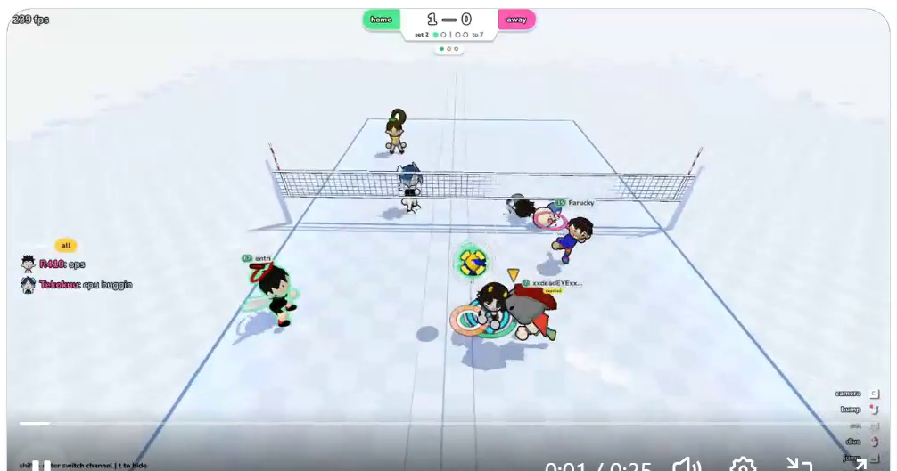
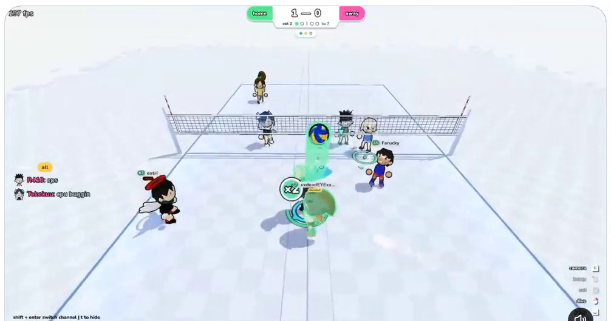
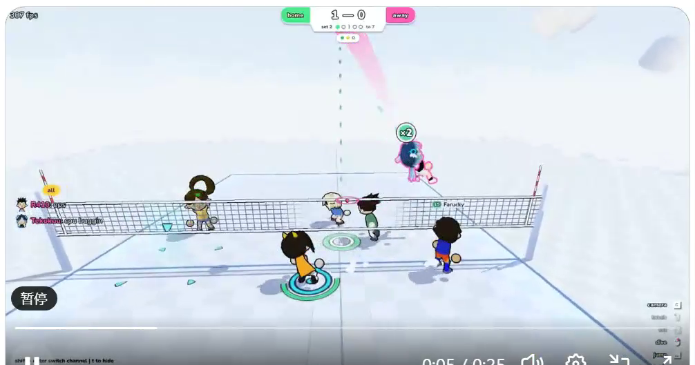
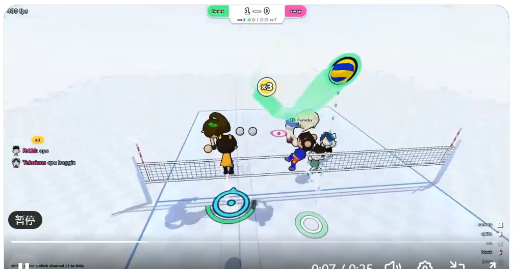
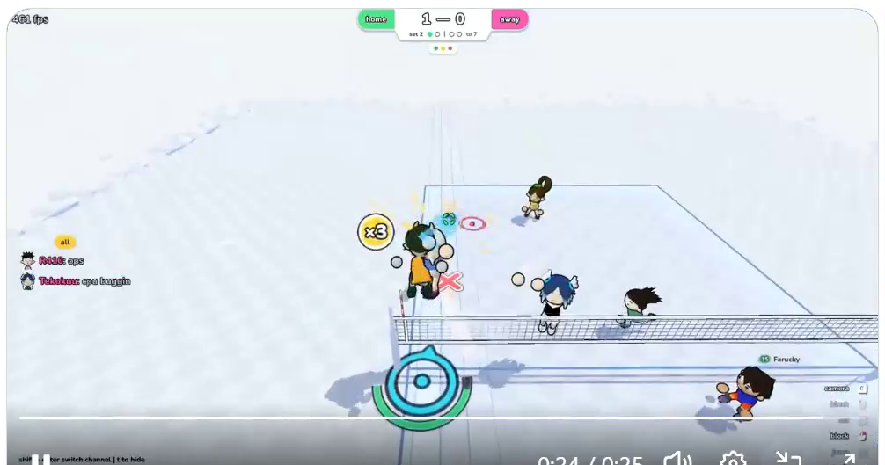
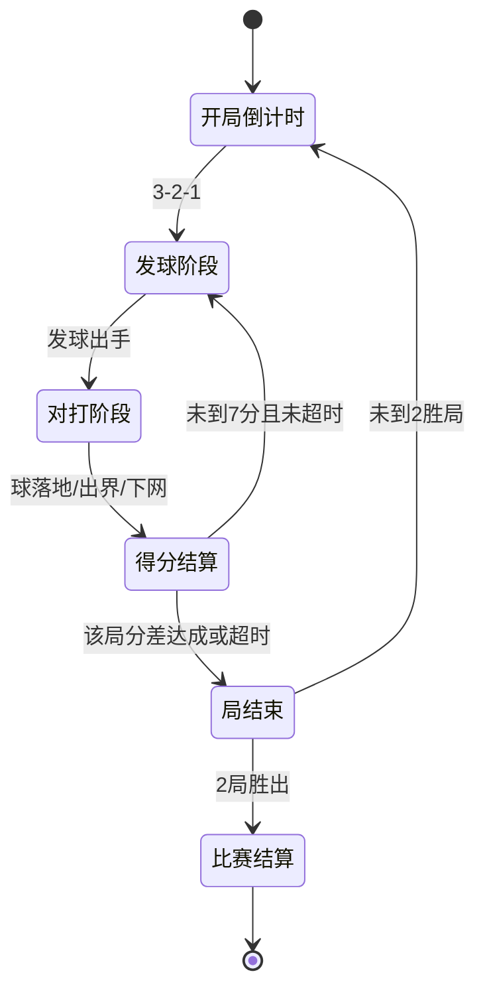

# 在线 Q 版排球游戏 需求文档（PRD）

| 项目 | 内容 |
| --- | --- |
| 文档版本 | v1.0 |
| 日期 | 2026-10-23 |
| 状态 | 初稿，待评审 |
| 平台 | 网页端（PC 浏览器优先） |
| 参考素材 | 用户提供的实机录屏（3D 卡通风格在线排球，beta build） |

> 本文档中的游戏截图均截取自参考录屏，仅用于画面与交互对标说明。

---

## 1. 项目概述

### 1.1 背景

参考对象是一款处于 beta 阶段的 3D 卡通风格在线排球对战游戏：2v2 实时对抗、Q 版小人、强打击反馈、带聊天与社交元素。市面上「大而重」的体育游戏中排球品类偏少，休闲向、开箱即玩、能和朋友开黑的网页排球是空白机会点。

### 1.2 产品定位

- **一句话定位**：网页端开箱即玩的 Q 版 3D 在线排球，和朋友来一局的轻竞技游戏。
- **品类**：休闲竞技 / 体育派对游戏
- **单局时长**：1 个 Set 约 40 秒～2 分钟，整场（3 局 2 胜）约 3～6 分钟
- **核心关键词**：上手 10 秒、打击感强、社交开黑、卡通减压

### 1.3 目标用户

| 用户群 | 特征 | 核心诉求 |
| --- | --- | --- |
| 学生/办公室玩家 | 课间、午休碎片时间 | 免下载、点开就玩、单局短 |
| 朋友小群体 | 2~4 人开黑 | 房间码邀请、语音外的文字/表情互动 |
| 休闲竞技玩家 | 玩过排球部落、超级鸡马类 | 有操作上限（时机扣球、扑救）但门槛低 |

### 1.4 设计支柱

1. **秒懂秒会**：不教学也能玩，规则一句话讲完（别让球落地，三次内打过去）。
2. **反馈拉满**：每次触球都有数字、音效、粒子、镜头四重反馈，"扣中一球爽一下"。
3. **轻社交**：聊天、表情、个性化外观，让输赢都有话说。

### 1.5 核心体验

> 我操控一个 Q 版小人在雪地球场上和队友打配合，跳起来一记重扣砸在对方场地空档，屏幕弹出连击数字和粒子特效，对面打出"？？？"，我回一个"😎"，再来一局。

---

## 2. 参考原型分析

### 2.1 画面总览

整体为固定后上方 3/4 俯视角，己方（home，绿）在近侧、对方（away，粉）在远侧，白色雪地场景 + 蓝色球场线，视觉干净、角色高饱和突出。

### 2.2 画面元素拆解清单

| 区域 | 元素 | 说明 |
| --- | --- | --- |
| 顶部中央 | 记分板 | 绿色胶囊 `home` vs 粉色胶囊 `away`，中间大号比分（如 `1 — 0`）；下方 `set 2` + 得分进度点（`○●○○ to 7`，表示先到 7 分）；再下方 3 个圆点表示局数（3 局 2 胜） |
| 顶部中央上方 | 白色胶囊计时器 | 回合倒计时（录屏中显示 `40s`） |
| 左侧 | 聊天面板 | 频道标签（`all`）、玩家头像、彩色昵称、消息文本，实时滚动 |
| 右下 | 竖排功能菜单 | `camera`（视角）/ `bump`（传球?）/ `chat`（聊天）/ `leave`（离开），带小图标 |
| 左下 | 操作提示 | `press enter to chat`、`shift+enter 切换频道 | ↑ to ...` 等快捷键提示 |
| 场地 | 球场 | 白色棋盘格纹理地面、蓝色边线、中间排球网、红白相间天线柱 |
| 角色 | Q 版小人 2v2 | 大头小身体，多样服装配色；头顶昵称 + 彩色数字徽标（如 13、02，疑似等级/号码）；己方绿色描边光、对方橙红色环区分阵营 |
| 球 | 排球 | 黄底蓝色旋涡纹；可击打时球周有脉冲圆环提示 |
| 特效 | 多种 | 见 3.4 节 |
| 底部中央 | 版本水印 | `beta build - content nonfinal` |

---

## 3. 画面与美术需求

### 3.1 镜头系统

| 编号 | 需求 | 说明 |
| --- | --- | --- |
| C-1 | 基础视角 | 固定于己方半场正后方，高度约 6m、俯角约 30°，看到整个球场（参考图视角） |
| C-2 | 动态跟随 | 镜头随球位置做小幅平移/缩放（球飞远时轻微拉近焦点），无旋转 |
| C-3 | 得分镜头 | 球落地得分时短暂慢动作（0.5x，约 1s）+ 轻微推近落点 |
| C-4 | 视角切换 | 右下 `camera` 菜单可切换 2~3 档预设（默认 / 更高俯视 / 贴地），P1 期可选实现 |

### 3.2 场景美术

| 编号 | 需求 | 参数/说明 |
| --- | --- | --- |
| S-1 | 球场尺寸 | 场地 16m × 8m（游戏单位，短于真实球场，节奏更快），中网分隔 |
| S-2 | 地面 | 白色底 + 浅灰棋盘格纹理（雪地感），粗糙度低、略带高光 |
| S-3 | 边界线 | 蓝色边线与中线，线宽约 0.1m，贴地不产生锯齿 |
| S-4 | 球网 | 深色网格贴图 + 上下白色包边，两端红白相间天线柱；网高 2.0m（可配置） |
| S-5 | 天空与远景 | 浅色纯色/渐变天空，远景漂浮 2~3 个装饰性低模方块/雪丘，营造空间感 |
| S-6 | 光照 | 单方向光 + 环境光，角色/球投射软阴影（性能允许时用 blob shadow 代替实时阴影） |

### 3.3 角色美术

| 编号 | 需求 | 说明 |
| --- | --- | --- |
| R-1 | 造型比例 | Q 版 chibi：头身比约 1:1.2，大头小手短腿，圆润无棱角 |
| R-2 | 部件构成 | 身体、头、双臂、双腿可分离绑骨；支持换色/换装（帽子、发型、服饰） |
| R-3 | 阵营标识 | 己方：绿色描边光 + 脚下绿色光环；对方：橙红色环；一眼可分敌我 |
| R-4 | 头顶信息 | 昵称（描边白字）+ 彩色数字徽标（等级或号码，可配置） |
| R-5 | 动作清单 | 待机呼吸、跑动、冲刺、跳跃、扣球挥臂、垫球/托球、扑救飞扑、倒地、得分庆祝、失分沮丧，共约 10 组，每组 1 个循环或单次动画 |
| R-6 | 队伍配色 | 支持两队各选主题色（默认绿/粉），角色服装继承主题色 |

### 3.4 排球与特效

**球体**

- 外观：黄底 + 蓝色旋涡纹排球，直径约 0.4m（略大于真实比例，更醒目）
- 可击打提示：球进入可击打范围时，球周围显示脉冲圆环（呼吸动画）
- 接球者提示：系统判定的接球者头顶显示橙黄色倒三角指示

**特效清单**

| 编号 | 特效 | 触发时机 | 表现 |
| --- | --- | --- | --- |
| FX-1 | 弹道预览 | 发球蓄力时 | 从球引出虚线抛物线（录屏中为粉色虚线），显示预计落点 |
| FX-2 | 球拖尾 | 球速 > 阈值 | 白色/青色残影拖尾，速度越快尾越长 |
| FX-3 | 冲刺烟尘 | 冲刺/大力扣球起跳 | 绿色烟尘拖尾（角色脚部） |
| FX-4 | 命中数字 | 每次触球 | 球位置弹出黄色数字气泡（如 `29`、`43`），见 4.5 连击系统 |
| FX-5 | 连击徽章 | 连击倍数 ≥2 | `x2`、`x3` 徽章随数字一同弹出 |
| FX-6 | 落地粒子 | 球落地得分 | 落点爆开青绿色圆环 + 小三角碎片飞散 |
| FX-7 | 得分横幅 | P1 | 屏幕中央短暂显示 `TEAM SCORED!` 类文案 |

### 3.5 UI / HUD

**记分板（顶部中央）**

- 结构：`home`（绿胶囊）+ 大号比分 `1 — 0` + `away`（粉胶囊）
- 第二行：`set N` + 得分进度点 `○●○○ to 7`（当前局比分点阵，直观显示距 7 分的差距）
- 第三行：局数点（3 个圆点，赢一局点亮一个）
- 记分板上方独立胶囊：回合倒计时（40s，最后 5s 变红闪烁）

**其他 UI**

| 编号 | 模块 | 需求 |
| --- | --- | --- |
| U-1 | 聊天面板 | 左侧半透明，显示频道标签（`all` / `队伍`）、头像、彩色昵称、消息；最近 N 条滚动；可折叠 |
| U-2 | 功能菜单 | 右下竖排：camera（视角）/ bump（快捷表情轮盘）/ chat（聊天）/ leave（离开房间），图标 + 文字 |
| U-3 | 操作提示 | 左下常驻快捷键提示，新手期显示、可在设置关闭 |
| U-4 | 房间/匹配界面 | 大厅页：模式选择（练习/创建房间/快速匹配）、昵称输入、外观选择入口 |
| U-5 | 结算界面 | 显示比分、MVP（得分最高者）、`再来一局` / `返回大厅` 按钮 |
| U-6 | 设置面板 | 音量（BGM/音效分开）、画质档位、镜头档位、键位说明、隐藏聊天 |

---

## 4. 核心玩法需求

### 4.1 比赛规则

| 规则项 | 设定 |
| --- | --- |
| 对战人数 | 2v2（同队 2 人，各守半场，可自由跑位） |
| 触球限制 | 每方最多 3 次触球，第 3 次触球必须过网（拦网不计数，与真实排球一致可简化为计数，见开放问题） |
| 同人触球 | 同一玩家不得连续触球 2 次（简化：允许，但第 2 次力度减半，见开放问题） |
| 得分 | 球落地在对方场地 → 己方得分；球出界/下网 → 对方得分 |
| 计分 | 先到 **7 分** 赢一局（Set），**3 局 2 胜** |
| 回合计时 | 每局 40s 倒计时；时间到时当前分高者胜，平分则加打"突然死亡"下一分定胜负 |
| 发球 | 得分方发球；发球方位于底线后，蓄力决定力度，虚线弹道预览（FX-1） |
| 边界 | 压线球算界内（休闲向判定从宽） |

### 4.2 回合流程（状态机）

- **发球阶段**：发球者锁定在底线，其余玩家可站位；发球者蓄力（按住时间 0~1s 映射力度），显示弹道预览
- **对打阶段**：自由移动与触球；球在空中时系统实时计算"最佳接球者"并显示头顶三角
- **得分结算**：慢动作 + 粒子 + 记分板跳动，2s 后进入下一回合

### 4.3 动作系统

| 动作 | 触发 | 判定与效果 |
| --- | --- | --- |
| 移动 | WASD / 方向键 | 己方半场内自由移动，不能过网 |
| 冲刺 | Shift（按方向） | 短距离爆发位移，绿色烟尘拖尾；冷却 3s；冲刺中触球 = 扑救（飞扑动作+倒地） |
| 跳跃 | Space | 垂直起跳；起跳后 0.6s 内可接扣球/拦网指令 |
| 垫球/托球 | J（地面） | 稳妥地把球垫向己方二传位（自动瞄准队友方向），数字低 |
| 扣球 | J（空中，球在上方） | 按住方向选择落点，力度由起跳时机决定（见 4.5）；扣球球速快、拖尾长 |
| 拦网 | K（网前空中） | 网前起跳后按 K，张开双臂，判定为网前竖直屏障；拦中直接弹回对方场内 |
| 扑救 | 冲刺中触球 | 向球方向飞扑，扑救后倒地 0.8s 硬直（高风险高回报） |

### 4.4 触球判定

- 判定方式：球与角色以**距离判定**（球心与角色上半身包围盒距离 < 1.2m 且相对时机合法）
- 优先级：拦网判定 > 扣球判定 > 普通触球判定
- 挥臂窗口：触球前 0.15s ~ 触球后 0.1s 内的指令有效（网络对局中以服务器时间戳为准）
- 球的物理：**自写抛物线弹道**（休闲游戏无需刚体物理），扣球可带轻微弧线；网碰撞做简化矩形碰撞（撞网按出界处理或弹回，取弹回更宽容）

### 4.5 连击与打击反馈系统（核心爽点）

录屏中每次触球弹出数字（`29`、`43`）并出现 `x2`、`x3` 徽章，设计如下：

| 系统项 | 规则 |
| --- | --- |
| 击球数值 | 每次触球弹出"击球力度值"：基础 10~50，由**击球时机完美度**决定（完美窗口内 = 40~50，普通 = 20~30，勉强碰到 = 10） |
| 扣球加成 | 扣球数值 ×2 显示 |
| 连击倍数 | 己方本回合连续触球过网次数达成 2 次、3 次时，弹出 `x2` / `x3` 徽章 |
| 数值作用 | 纯观赏与反馈（不影响物理），数值越大特效越强、音效音调越高；季度目标：让"完美扣球 100 分"成为玩家炫耀截图 |
| 表现 | 黄色数字气泡从球位置向上弹出并放大消失；连击徽章带描边与抖动 |

### 4.6 人机 AI（练习模式）

| 难度 | 行为 |
| --- | --- |
| 简单 | 移动速度 70%，接球反应延迟 0.4s，不主动扣球，偶尔漏球 |
| 普通 | 正常速度，会二传 + 扣球，扑救成功率 30% |
| 困难 | 反应延迟 0.15s，会拦网、吊球（假动作扣成轻放），扑救成功率 60% |

AI 行为树：追球（距球最近者）→ 选位（非追球者回二传位）→ 触球决策（第 1 次垫、第 2 次托、第 3 次扣）→ 无球跑位补空档。

---

## 5. 操作与控制需求

参考录屏为键盘操作（提示 `press enter to chat`），方案如下：

| 按键 | 功能 |
| --- | --- |
| W / A / S / D（或方向键） | 移动 |
| Shift | 冲刺（方向 = 当前移动方向） |
| Space | 跳跃 |
| J | 击球（地面=垫/托球，空中=扣球） |
| K | 拦网（网前空中） |
| Enter | 打开聊天输入 |
| Shift + Enter | 切换聊天频道（all / 队伍） |
| Esc | 设置/离开菜单 |
| 鼠标（可选，P2） | 点击选择扣球落点 |

**手感参数基线（可调）**

| 参数 | 数值 |
| --- | --- |
| 移动速度 | 6 m/s |
| 冲刺速度 / 时长 / 冷却 | 11 m/s / 0.4s / 3s |
| 跳跃初速度 / 重力 | 8 m/s / 22 m/s²（卡通快落） |
| 扣球球速 / 垫球球速 | 18 m/s / 9 m/s |
| 触球判定半径 | 1.2 m |
| 完美击球窗口 | 触球点前后 ±0.15s |
| 倒地硬直 | 0.8s |

---

## 6. 游戏模式需求

| 模式 | 人数 | 说明 | 优先级 |
| --- | --- | --- | --- |
| 练习模式 | 1v2 人机或 2v2 人机 | 无联网可玩，选难度；用于熟悉操作 | P0 |
| 好友房间 | 2v2 | 创建房间生成 6 位房间码，好友输入加入；可替补 AI 凑人；房主可开赛/踢人 | P1 |
| 快速匹配 | 2v2 | 服务器按段位/等待时间匹配；人数不足补 AI | P1 |
| 观战 | — | 好友房间支持链接观战 | P2 |

**房间流程**：创建/加入房间 → 大厅内选边、换装、发快捷表情 → 全员准备 → 房主开赛 → 结算 → `再来一局`（保留房间）。

---

## 7. 联网与技术需求

### 7.1 客户端技术栈

| 层 | 选型 | 理由 |
| --- | --- | --- |
| 渲染 | Three.js（或 Babylon.js） | 网页 3D 事实标准，低模卡通渲染成本低 |
| 物理 | 自写弹道模块 | 球只做抛物线 + 简化碰撞，无需引入完整物理引擎 |
| 动画 | glTF + AnimationMixer | Q 版低模骨骼动画，单角色面数控制在 5k 以内 |
| 音频 | Web Audio API | 触球/得分音效随机变调增强反馈 |
| 通信 | WebSocket | 状态同步 |

### 7.2 网络架构

- **模型**：服务端权威 + 状态同步。球的位置/速度、比分、回合状态由服务器计算广播；客户端只上报输入（移动方向、动作指令 + 时间戳）
- **频率**：服务器 15~20 Hz 广播快照；客户端插值渲染 60fps
- **延迟目标**：同区域 RTT < 80ms 时操作跟手；输入延迟补偿（挥臂窗口放宽至 ±0.2s 服务器判定）
- **协议消息**：`join / input / snapshot / score / chat / emote / reconnect`，JSON 起步（P2 可换二进制）

### 7.3 服务端

| 模块 | 职责 |
| --- | --- |
| 网关 | WebSocket 接入、鉴权（临时游客 ID / 昵称） |
| 房间服务 | 创建/加入/匹配、房间状态机、AI 补位 |
| 战斗服务 | 权威物理与规则结算（每房间独立 tick 循环） |
| 聊天转发 | 频道消息广播、敏感词过滤 |

初期单机部署（Node.js + ws 单进程多房间）即可支撑百人级在线，无需上分布式。

### 7.4 断线重连

- 掉线后房间保留 30s，玩家可凭会话重连并回放最近快照
- 超时未归：由 AI 接管该角色，队友可继续比赛

### 7.5 基础防作弊

- 所有比分与触球判定以服务器为准，客户端输入仅作意图
- 输入频率校验（防脚本秒移）、聊天敏感词过滤

---

## 8. 周边系统需求

| 系统 | 需求 | 优先级 |
| --- | --- | --- |
| 聊天 | 频道（all/队伍）、预设快捷短语、回车发送；输入框打开时移动键不生效 | P1 |
| 表情 | 快捷表情轮盘（bump 键呼出），头顶气泡展示（😎😡？？？） | P1 |
| 外观 | 昵称 + 服装配色选择（初始 6 套配色），皮肤商店 P2 | P1/P2 |
| 音效 | 触球（按力度变调）、扣球重音、得分欢呼、倒计时滴答、BGM 1 首 | P0 |
| 战绩 | 本地记录胜场/总得分；排行榜 P2 | P2 |

---

## 9. 数值设定建议汇总

| 项 | 数值 |
| --- | --- |
| 每局目标分 / 局数 | 7 分 / 3 局 2 胜 |
| 每局时长 | 40s |
| 球场 | 16m × 8m，网高 2.0m |
| 触球上限 | 3 次 |
| 冲刺 | 0.4s / 冷却 3s |
| 完美击球窗口 | ±0.15s |
| 击球数值 | 10~50（扣球 ×2） |
| 单局实际对打时长 | 60~120s |

---

## 10. 非功能需求

| 项 | 指标 |
| --- | --- |
| 性能 | 中端笔记本核显下稳定 60fps；首屏资源 ≤ 15MB（模型+贴图压缩），加载 ≤ 5s |
| 兼容 | Chrome / Edge / Firefox / Safari 近两年版本；分辨率 1280×720 起步自适应，支持 16:9 与 16:10 |
| 外设 | 键盘必选；手柄 P2 考虑；移动端触屏不在本期范围（开放问题） |
| 可用性 | 服务可用性 99%；掉线重连成功率 > 95% |
| 合规 | 无实名/内购则暂不需版号流程；聊天需敏感词过滤与举报入口 |

---

## 11. 版本规划与验收标准

| 阶段 | 范围 | 验收标准 |
| --- | --- | --- |
| **P0 单机闭环** | 画面（镜头/场景/角色/球/特效全案）、完整规则与计分、操作与手感、人机 AI、音效、结算流程 | 单人可在浏览器完成一整场 2v2 人机对局；触球/扣球/拦网/扑救全部可用；60fps；打击反馈四件套（数字/音效/粒子/慢动作）齐备 |
| **P1 联机对战** | WebSocket 服务端、好友房间（房间码）、快速匹配、断线重连、聊天与表情、AI 补位 | 2 台设备房间码联机对局流畅；RTT<80ms 无可感延迟；掉线 30s 内重连恢复；聊天/表情正常收发 |
| **P2 打磨增长** | 外观商店、战绩/排行榜、观战、手柄、移动端评估、二进制协议优化 | 留存相关指标另行定义 |

里程碑顺序：**先让一个人玩得爽（P0），再让两个人玩得起来（P1），最后让人想一直玩（P2）。**

---

## 12. 风险与开放问题

| 编号 | 问题 | 当前倾向 | 状态 |
| --- | --- | --- | --- |
| Q1 | 拦网是否占用 3 次触球计数 | 不计数（降低挫败感） | 待定 |
| Q2 | 同一玩家连续触球是否允许 | 允许但力度减半（单人也能玩起来） | 待定 |
| Q3 | 参考视频中数字 29/43 的原始规则 | 按 4.5 节自拟（时机决定力度值） | 待逆向确认 |
| Q4 | 回合倒计时 40s 的确切作用域（每局 vs 每回合） | 每局 | 待逆向确认 |
| Q5 | 是否支持移动端触屏 | P2 再评估，虚拟摇杆+按钮方案预研 | 待定 |
| Q6 | 角色技能/大招系统（参考游戏未见） | 一期不做，保持纯技术对抗 | 待定 |
| Q7 | 美术资产来源 | 外包定制 vs 购买低模库改造 | 待定 |

---

## 附录 A：参考截图索引

| 文件 | 内容 |
| --- | --- |
| `images/scene_overview.png` | 画面总览：记分板、聊天、2v2 布局、雪地球场 |
| `images/camera_view.png` | 镜头视角与场地纵深 |
| `images/serve_trajectory.png` | 发球虚线弹道预览 |
| `images/dash_effects.png` | 冲刺绿色烟尘拖尾、场地特效 |
| `images/hit_number_combo.png` | 触球数字气泡（连击反馈） |
| `images/combo_landing_fx.png` | x3 连击徽章、球拖尾、落地粒子 |
| `images/scoreboard_ui.png` | 记分板细节：home/away、比分、set 进度点 |
