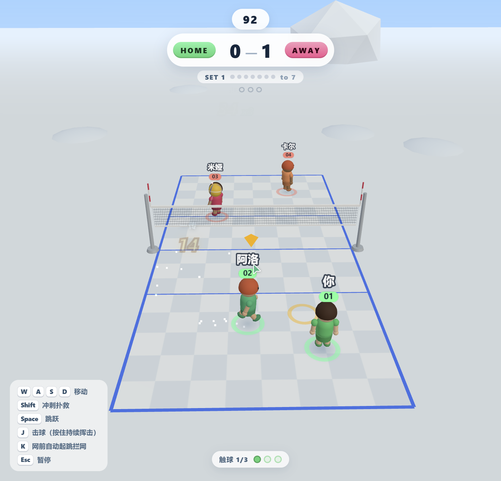
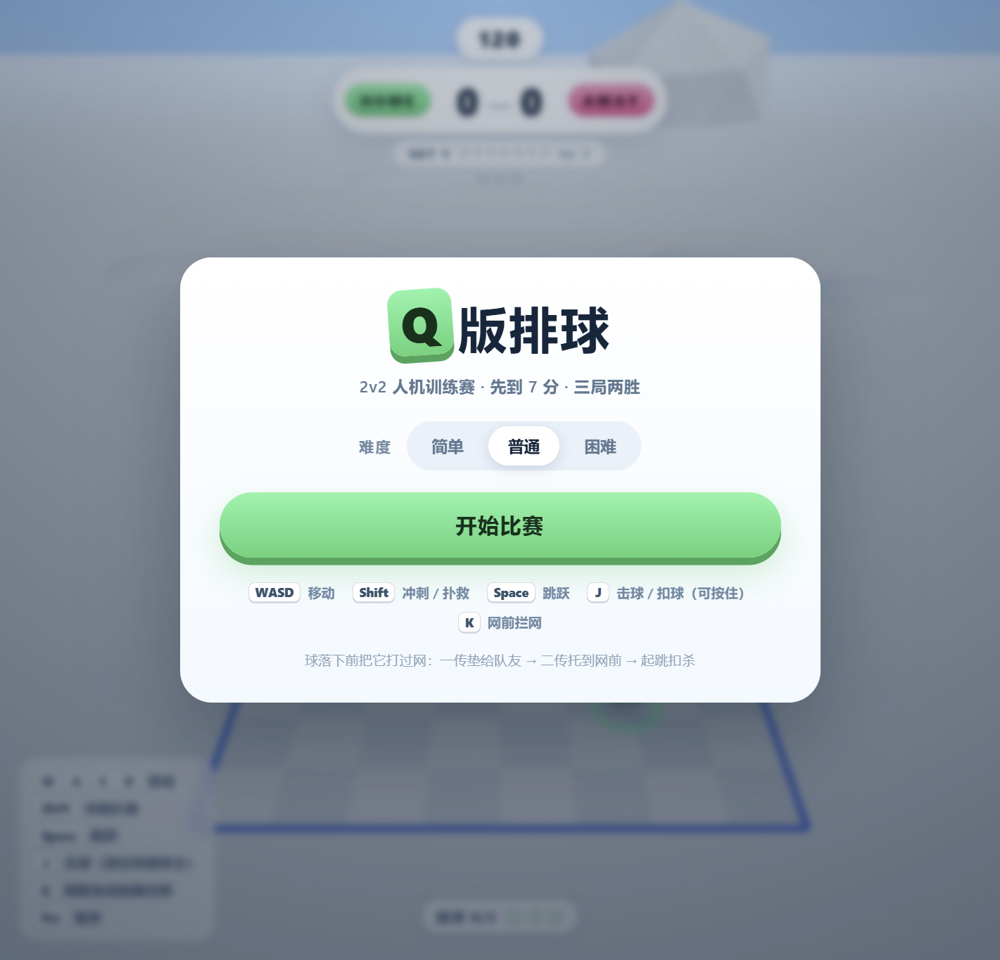
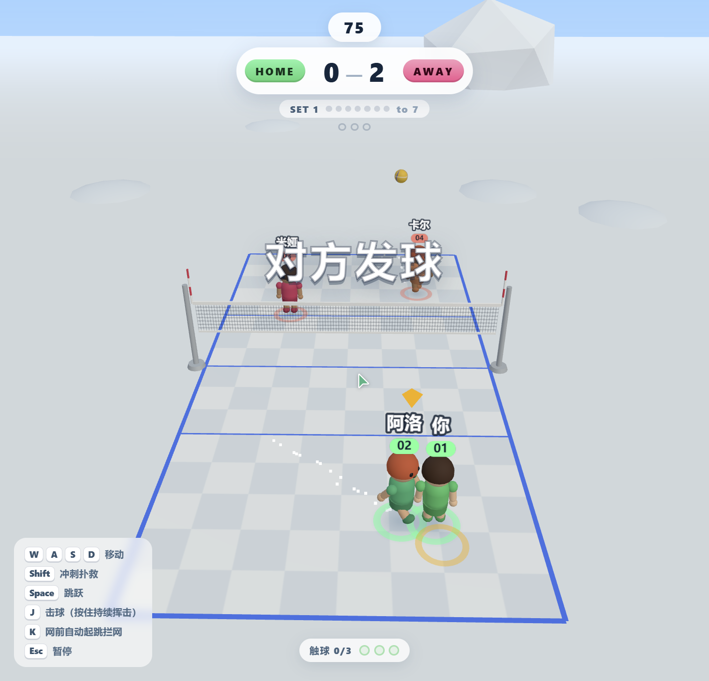
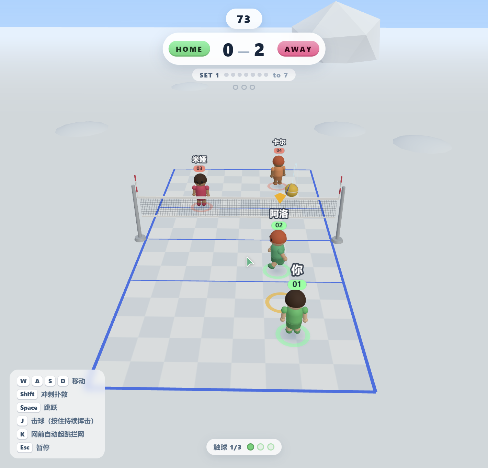

# Q-Volleyball

[简体中文](README.md) | English

A chibi-style 3D volleyball game that runs right in the browser, playable against AI. Fixed 3/4 top-down camera, 2v2 matches, first to 7 points, best of 3 sets.



## Screenshots

| Start screen | Opponent serving |
| --- | --- |
|  |  |

| Net battle | Hit feedback |
| --- | --- |
|  |  |

## What's in Phase 1

- 3D court, chibi characters, ball and scene rendering (Three.js + Rapier physics)
- Full match loop: charged serve → bump / set / spike → block → point → serve change → set break → results
- AI opponents with three difficulties (Easy / Normal / Hard), plus teammate AI that positions and covers automatically
- Impact feedback: hit numbers, combos, particles, camera effects and SFX (`M` to mute)
- HUD: scoreboard, countdown, touch counter, serve power bar, announcements and post-match MVP
- Deployed online on Miaoda

## Controls

| Key | Action |
| --- | --- |
| `W` `A` `S` `D` | Move |
| `Shift` | Dash / dive |
| `Space` | Jump |
| `J` | Hit / spike (hold to keep charging the swing) |
| `K` | Auto-jump block near the net |
| `Esc` | Pause |
| `M` | Toggle sound |

## Run locally

```bash
npm install
npm run dev      # dev server
npm run build    # type check + production build (outputs dist/)
npm run preview  # preview the build
```

## Tech stack

TypeScript + Vite + Three.js + Rapier (physics) + tween.js (tweening).

## Project structure

```
src/
  main.ts            Entry point: scene setup and UI wiring
  game.ts            Main game loop and state machine
  sim/               Pure logic: physics, ball, AI, formations, config
  render/            Presentation: scene, arena, characters, ball, VFX
  input/             Keyboard input
  ui/hud.ts          HUD and screens
  audio/audio.ts     Procedural SFX
  core/              Event bus and math helpers
docs/screenshots/    Screenshots
.trae/               PRD and art reference images
```

## Release convention

Versions follow Semantic Versioning and stay in sync with `version` in `package.json`.

Every release goes through the same steps:

1. Bump `version` in `package.json`
2. Update the changelog below
3. Commit: `git commit -m "release: vX.Y.Z <summary>"`
4. Tag and push: `git tag -a vX.Y.Z -m "vX.Y.Z"` → `git push origin main --tags`
5. Create a GitHub Release with the same tag and list the changes

Day-to-day commits use the `feat: / fix: / refactor: / docs: / chore:` prefixes; release commits use `release:`.

## Changelog

### v0.2.0 — Phase 2 · Chibi character visual upgrade

- Rebuilt character proportions: bigger head, shorter limbs, feet grounded
- New face: large eyes with highlights, blush and smile, plus blinking and mood expressions
- Four procedural hairstyles (bob / side part + headband / ponytail / twin buns) with back-of-head coverage
- Jersey details: short sleeves, cuffs, side stripes, back numbers, knee pads, socks, shoes and wristbands
- Toon outlines on head and torso, raised name tag, clearer character silhouettes

### v0.1.0 — Phase 1

- Complete AI match is playable
- Three AI difficulties and teammate AI positioning
- Hit VFX, SFX and full HUD
- Online deployment on Miaoda
